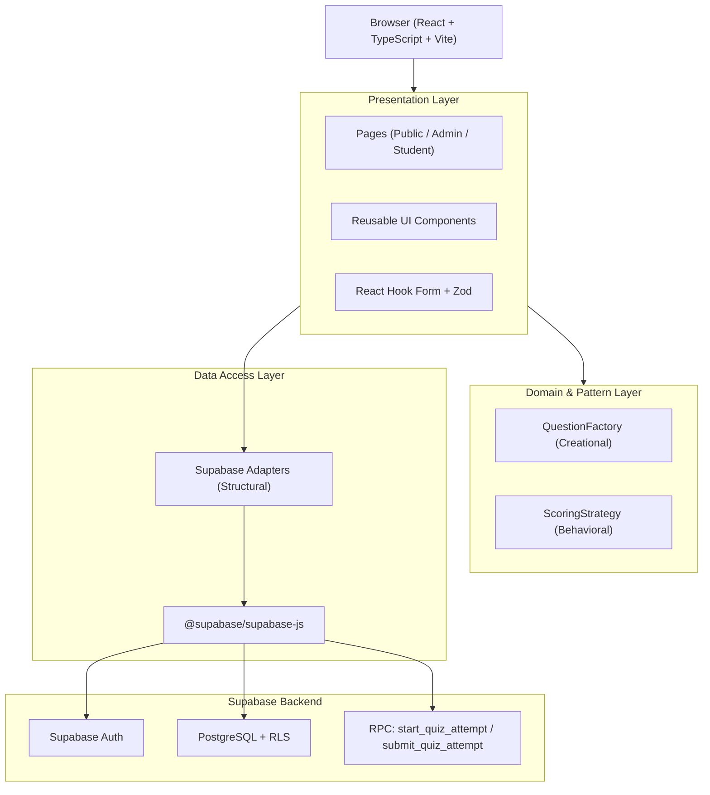
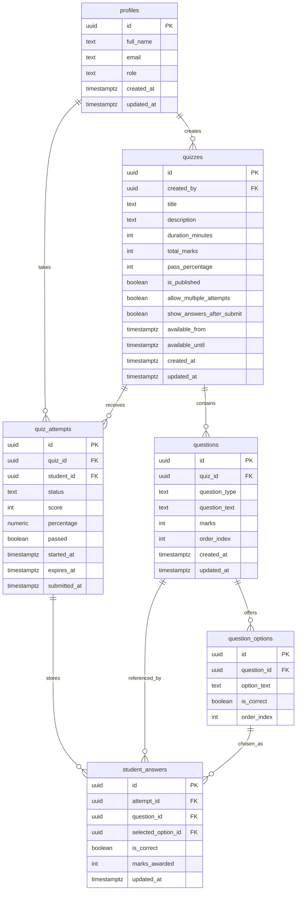
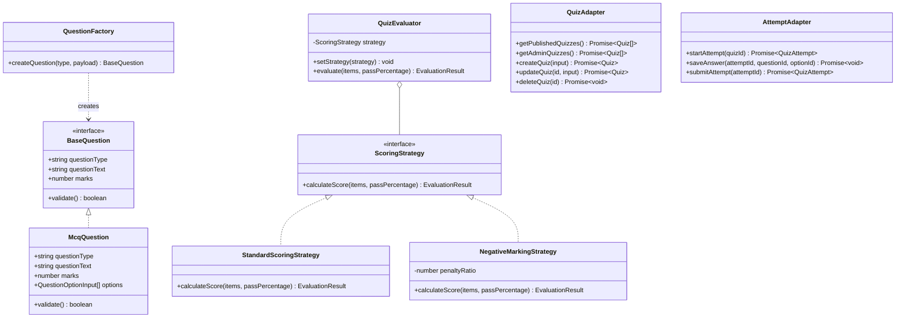

# Phase 2: System Design — QuizMaster

## 1. Software Architecture

QuizMaster follows a layered **Client-Server Architecture** with a React + TypeScript Single Page Application (SPA) communicating with Supabase (PostgreSQL + Auth + RLS + RPC).



---

## 2. Database ER Diagram



---

## 3. UML Class Diagram (Design Patterns)



---

## 4. Design Pattern Justifications

### A. Factory Pattern (Creational) — `QuestionFactory`
- **Problem Solved:** Question creation requires type-specific validation (e.g., an MCQ must have 4 options and exactly 1 correct option). Putting this inside UI components couples the form to a single question type.
- **Rejected Alternative:** Inline `if/else` object literals inside `QuestionsPage.tsx`, which duplicates validation and makes adding True/False or Short Answer questions fragile.
- **Why Suitable:** Centralizes creation and validation in one place, making future question types easy to plug in.

### B. Adapter Pattern (Structural) — `quizAdapter`, `questionAdapter`, `attemptAdapter`
- **Problem Solved:** Supabase SDK queries use database column names (`snake_case`) and return `{ data, error }` envelopes. Exposing that directly to React components couples UI code to the database schema.
- **Rejected Alternative:** Calling `supabase.from('quizzes').select(...)` directly inside React components and hooks.
- **Why Suitable:** Isolates database access behind clean domain methods, simplifies error handling, and makes unit testing trivial by mocking the adapter.

### C. Strategy Pattern (Behavioral) — `ScoringStrategy`
- **Problem Solved:** Different quizzes or future grading policies may require different scoring rules (standard scoring vs. negative marking).
- **Rejected Alternative:** Hardcoding a single `calculateScore` function with boolean flags (`if (negativeMarking) ...`), which violates the Open/Closed Principle.
- **Why Suitable:** Encapsulates each scoring algorithm behind a common `ScoringStrategy` interface so new rules can be added without modifying `QuizEvaluator`.

---

## 5. UI Wireframes (Textual Mockups)

### Student Quiz Attempt Interface
```text
+------------------------------------------------------------------+
| QuizMaster          [Quiz Title]               Time Left: 14:32  |
+------------------------------------------------------------------+
| Question 2 of 10                                  (2 Marks)      |
|                                                                  |
| What does RLS stand for in PostgreSQL / Supabase?                |
|   ( ) Role Level Security                                        |
|   (*) Row Level Security                                         |
|   ( ) Relational Lock System                                     |
|   ( ) Remote Login Service                                       |
|                                                                  |
| [ Previous ]                              [ Save & Next ]        |
+------------------------------------------------------------------+
| Question Navigator: [1*] [2*] [3 ] [4 ] ...      [ Submit Quiz ] |
+------------------------------------------------------------------+
```

### Admin Dashboard
```text
+------------------------------------------------------------------+
| QuizMaster Admin  | Dashboard | Quizzes | Results | Logout       |
+------------------------------------------------------------------+
| [Total Students: 42] [Total Quizzes: 8] [Published: 6] [Avg: 78%]|
+------------------------------------------------------------------+
| Recent Student Activity                                          |
| - Alice Rahman   | Data Structures Quiz 1 | 90% (Passed)         |
| - Bob Karim      | Software Eng. Midterm  | 65% (Passed)         |
+------------------------------------------------------------------+
```
